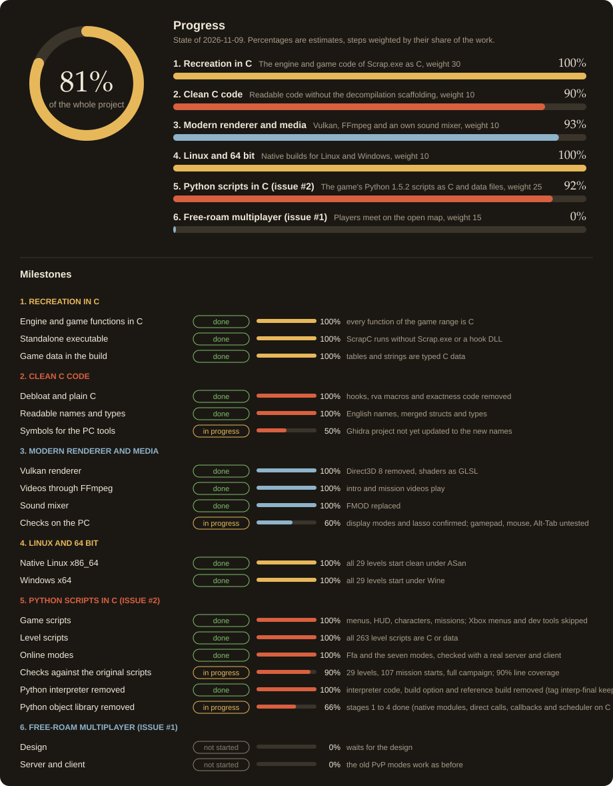

  

<h1 align="center">ScrapC</h1>

A recreation of Scrapland Remastered in C that runs natively on Linux and Windows.

## What is this?

ScrapC is a fan project that rebuilds Scrapland Remastered 1.6.1 (the GOG build) in C. It was made by studying how the original game works, function by function, and writing new code that does the same. It contains none of the original code, and it behaves like the original game.

It is not affiliated with MercurySteam or the publishers.

## What you need

ScrapC does not include any game files. You need the game files of a legally owned Scrapland Remastered, the `.packed` files of the GOG release. Install the game as usual and ScrapC will use its data.

## What it gives you today

- Runs natively on Linux and on Windows, 64 bit.
- A Vulkan renderer. Direct3D 8 is gone.
- Videos play through FFmpeg.
- Its own sound mixer replaces the old FMOD.
- No GOG or Steam account features. The store code was removed.
- A Display option in the video settings: Windowed, Borderless or Fullscreen.
- The window can be resized, and the game renders at the real window size.

## Progress

Close to four fifths of the whole project is done (the graphic shows 79%). The recreation in C, the clean code, the Vulkan renderer with FFmpeg videos and the own mixer, and the Linux and 64 bit builds are done or nearly done. The port of the Python scripts to C (issue #2) is at 84%: every game and level script is C or data and checked against the original scripts. Every pack module of the game, 310 in all (138 global and 172 level), is now made in C without its Python code. The code strings of the save games and the scenes run as C, the console has its own C command table, and the test tools talk to the game through a C channel. A build option without the Python interpreter (no parser, compiler or bytecode loop) already starts all 29 levels and all 107 mission starts. Making it the default build is the step left for the interpreter. Removing the Python object library has started: the C ports move to native C types module by module. The native value layer is done, and every module and level now runs on native C inside; the later stages, which make the modules call each other directly and take the Python types out, are next. The overall number once went down from 77% because the planned work grew (removing the object library was added), not because something was undone. The free-roam multiplayer (issue #1) is not started. The percentages are estimates, and each step is weighted by its share of the work (recreation in C 30, clean C code 10, renderer and media 10, Linux and 64 bit 10, Python scripts 25, multiplayer 15).

For developers: the graphic is drawn by `tools/progress/progress.py` from `tools/progress/progress.json`. Change the JSON when a milestone moves and run the script.

## Getting it

There are no ready-made downloads yet. For now you build it yourself. The steps are in [docs/building.md](docs/building.md).

## How to play

Once built, put ScrapC (Linux) or ScrapC.exe (Windows) together with its libraries into the Bin folder of your installed game. Start it from there, the same way you would start the original Scrap.exe.

On Linux, settings and saves go to your user data folder (`XDG_DATA_HOME`, normally `~/.local/share/MercurySteam/Scrapland`).

## Plans

- Free-roam multiplayer, where players meet on the open map instead of only the old PvP modes (issue #1).
- Porting the game's Python script system to C, step by step (issue #2).

## Prior work and thanks

This project builds on the work of the ReScrap community:

- ReScrap ScrapHacks: https://gitdab.com/ReScrap/ScrapHacks (`.packed` format, Kaitai specs, notes for the 2004 exe)
- ReScrap ScrapModLoader: https://gitdab.com/ReScrap/ScrapModLoader
- ReScrap ScrapMods: https://gitdab.com/ReScrap/ScrapMods

## Where the code lives

The code is hosted on Gitea at git.lixsl.net and mirrored to GitHub at https://github.com/Blackwolf1337/scrapland.

## For developers

- [Building and running](docs/building.md)
- [Testing](docs/testing.md)
- [Development notes](docs/development.md)
- [All documentation](docs/README.md)
